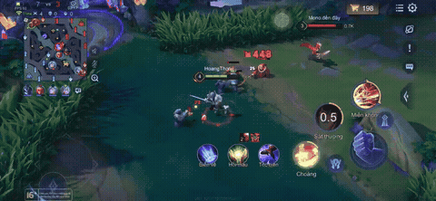

# BeatCut

**English** | [Tiếng Việt](README.vi.md)

[](https://github.com/HoangThongTom/beatcut/actions/workflows/ci.yml)

[](https://beatcut-hb8jo3fdd5dsrvthptc2qf.streamlit.app/)

Turn an hour-long gameplay VOD into a short montage that cuts on the beat of a song.

`BeatCut` scores every second of a recording for "how much is happening here",
picks the strongest moments, and cuts them into a highlight reel aligned to the
downbeats of a music track. No manual scrubbing, no editing timeline.

> **Status: working end to end.** Highlights come from motion energy, audio
> energy, and a kill counter read with OCR; clip lengths are quantised to whole
> bars so every cut lands on the beat. A learned detector (YOLO) is the next
> step. See [ROADMAP.md](ROADMAP.md).



*Ten seconds of an automatically generated montage: eight clips, each exactly
three bars long, picked from a 10-minute phone recording.*

[Watch the full 44-second montage with sound](https://beatcut-hb8jo3fdd5dsrvthptc2qf.streamlit.app/)
— eight highlights from an 11-minute gameplay recording, selected with kill-counter OCR.
The [MP4 demo](docs/assets/montage-demo.mp4) is also included in this repository.

In the web demo, upload gameplay and music, set the montage duration and music
start in seconds, then preview the music before rendering. For example, 25 starts
the music at 0:25. Final duration can vary to keep clips on musical bars.
During rendering, the demo shows the current stage, reused analysis, and the
number of highlight clips completed.

## The problem

Editing a highlight montage by hand means watching hours of footage, remembering
timestamps, and then manually cutting clips to the beat. It is the most tedious
part of making gaming content, and it is exactly the kind of repetitive
video-understanding task a model can do.

## How it works

```
video ──► probe ──► motion energy ─┐
                                   ├─► fuse ──► window scoring ──► greedy select
       └─► audio ──► loudness ─────┘                                      │
                                                                          ▼
music ──► beats/downbeats ─────────────────────────────► snap cut points to grid
                                                                          │
                                                                          ▼
                          ffmpeg: cut ─► concat ─► mix game audio + music
```

| Stage | Module | What it does |
|---|---|---|
| Probe | `media.py` | duration, resolution, fps, audio presence via `ffprobe` |
| Frame stream | `media.py` | decodes downscaled gray frames through an ffmpeg pipe |
| Scoring | `scoring.py` | frame-difference motion energy + short-time RMS loudness |
| Beats | `beats.py` | tempo, beats, downbeats (librosa) + snapping helpers |
| Selection | `select.py` | window scores, greedy top-k with a minimum gap |
| Render | `render.py` | re-encoded cuts, concat demuxer, game audio mixed under the music |

More detail, including the design decisions and their trade-offs, is in
[docs/architecture.md](docs/architecture.md).

## Quickstart

```powershell
# 1. ffmpeg is a hard dependency and is not installed by pip
winget install Gyan.FFmpeg
```

Prefer a portable build with no system install? Drop `ffmpeg.exe` and
`ffprobe.exe` anywhere and point the pipeline at them:

```powershell
$env:FFMPEG_BIN = "C:\tools\ffmpeg\ffmpeg.exe"
$env:FFPROBE_BIN = "C:\tools\ffmpeg\ffprobe.exe"
```

```powershell
# 2. create .venv (Python 3.11) and install
.\scripts\bootstrap.ps1

# 3. check the machine can actually run this
.\.venv\Scripts\Activate.ps1
beatcut doctor

# 4. render a montage
beatcut run data\raw\match.mp4 data\raw\song.mp3 -o outputs\montage.mp4
```

Put your own recording in `data/raw/`. Nothing in `data/` is committed: a
one-hour 1080p60 capture is several GB, far above what Git should hold.

### Smoke test without footage

`scripts/make_fixtures.py` builds a synthetic 40-second clip and a 120 BPM click
track, so the install can be checked before recording anything:

```powershell
python scripts\make_fixtures.py
beatcut run scratch\gameplay.mp4 scratch\music.wav -o outputs\smoke.mp4 --target-duration 12
```

A 12-second mp4 with audio means the whole chain (probe, scoring, beats, cut,
concat, mux) works.

## CLI

```text
beatcut doctor                     # environment check
beatcut analyze VIDEO MUSIC        # print the chosen clips, render nothing
beatcut run VIDEO MUSIC -o OUT     # full pipeline
beatcut kills VIDEO --box x,y,w,h  # OCR the in-game kill counter
beatcut score LABELS SELECTION     # precision@k against labels
beatcut version
```

Useful flags: `-c configs/default.yaml`, `--target-duration 60`,
`--max-segments 8`, `--keep-work`.

`beatcut analyze` writes nothing except the temp audio; it prints the segment
table and can dump JSON with `--json out.json`. This is the command used by the
evaluation protocol.

## Configuration

Every knob lives in [configs/default.yaml](configs/default.yaml) and maps 1:1 to
a field of `beatcut.config.Config`. Unknown keys are rejected, so a typo cannot
silently fall back to a default.

The two that matter most:

- `window_s` / `target_duration_s` — clip length and total montage length.
- `motion_weight` / `audio_weight` — how much on-screen action versus loud audio
  drives the selection. A quiet stealth game wants more motion; a shooter with a
  loud caster wants more audio.

## Results

Measured on one 11-minute phone recording (2532x1170, 60fps, HEVC), a 129 BPM
track, on an RTX 2050 laptop. Numbers are from real runs; the commands to
reproduce each are next to them.

| Metric | Measured | How |
|---|---|---|
| Clips containing a kill | **8/8** with the kill boost, **2/8** without | `beatcut run` with `kill_crop` on and off, same VOD and config |
| Kills found in an 11-min VOD | 11 | `beatcut kills` |
| Cut alignment to the bar grid | **≤ 15.4 ms** (half a frame at 60fps) | clip lengths are whole bars, rounded on the cumulative position |
| Kill counter OCR cost | **11 ms/frame** | text detection disabled, 62x52 crop at 3x |
| Analysis, first run / cached | **207 s / 2 s** | `beatcut analyze`, motion curve cached |
| Full render, first run / cached | **297 s / 57 s** | `beatcut run` |
| Highlight selection precision@5 | _not measured yet_ | needs hand-labelled VODs, see [eval protocol](docs/eval-protocol.md) |

### What the ablation does and does not show

Turning the kill boost on took clips that contain a kill from 2/8 to 8/8, and
every chosen window now sits within 1.5s of one. That is evidence the kill
detector works, **not** evidence the montage is good:

- "contains a kill" is not "worth watching" — a clip can contain the kill and
  still be the boring six seconds after it
- one VOD and eight clips is not a sample
- there is no independent ground truth yet, so this is a sanity metric rather
  than a quality metric

The honest number to fill in next is precision@5 against labelled highlights.


## Project layout

```
src/beatcut/     pipeline library (importable, no CLI side effects)
app/streamlit_app.py  Streamlit demo (the free deploy target)
app/ui.py        Gradio demo (kept for Hugging Face Spaces with PRO)
app/api.py       minimal FastAPI wrapper (M3)
configs/         YAML run configs
scripts/         bootstrap.ps1
tests/           pure-function unit tests (no ffmpeg, no models)
docs/            architecture, evaluation protocol
data/            raw footage and labels — gitignored
outputs/         rendered montages — gitignored
```

## Evaluation

`tests/` covers the pure logic (selection, snapping, config). Measuring whether
the *chosen clips are any good* is a different problem, and it needs human
labels. [docs/eval-protocol.md](docs/eval-protocol.md) describes the labelling
procedure and the precision/recall/IoU metrics.

## Roadmap

M1 (this repo) is model-free by design: it produces a real montage today. M2–M4
add learning, deployment and polish. The full checklist is in
[ROADMAP.md](ROADMAP.md).

## Limitations

- Beat tracking assumes 4/4 music; downbeats are a phase heuristic, not a
  trained downbeat model.
- Cuts are hard cuts. Crossfades and beat-matched transitions are M4.
- Music longer than the montage is fine; shorter music is padded with silence.
- One video in, one montage out — no multi-VOD stitching yet.

## License

MIT
