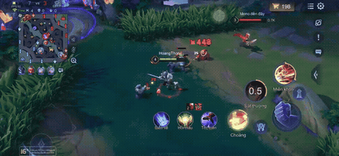

# BeatCut

[English](README.md) | **Tiếng Việt**

[](https://github.com/HoangThongTom/beatcut/actions/workflows/ci.yml)

[](https://beatcut-hb8jo3fdd5dsrvthptc2qf.streamlit.app/)

Biến một VOD chơi game dài cả tiếng thành đoạn montage ngắn cắt đúng nhịp nhạc.

`BeatCut` chấm điểm từng giây của bản ghi theo câu hỏi "chỗ này đang có bao nhiêu
chuyện xảy ra", chọn những khoảnh khắc mạnh nhất, rồi cắt thành highlight reel
khớp với phách của một bản nhạc. Không phải tua tay, không phải dựng timeline.

> **Trạng thái: chạy được end-to-end.** Điểm highlight đến từ năng lượng chuyển
> động, năng lượng âm thanh, và bộ đếm hạ gục đọc bằng OCR; độ dài mỗi clip được
> lượng tử hoá thành số ô nhịp nguyên nên mọi mối cắt đều rơi vào phách. Bước
> tiếp theo là một bộ dò có học (YOLO). Xem [ROADMAP.vi.md](ROADMAP.vi.md).



*Mười giây của một montage được tạo tự động: tám clip, mỗi clip đúng ba ô nhịp,
chọn ra từ một bản ghi màn hình điện thoại dài 10 phút.*

## Vấn đề

Dựng montage highlight bằng tay nghĩa là xem hàng giờ footage, nhớ timestamp, rồi
tự cắt từng đoạn cho khớp nhạc. Đó là phần chán nhất khi làm nội dung game, và
cũng đúng là kiểu việc hiểu video lặp đi lặp lại mà một mô hình có thể làm thay.

## Cách hoạt động

```
video ──► probe ──► motion energy ─┐
                                   ├─► fuse ──► window scoring ──► greedy select
       └─► audio ──► loudness ─────┘                                      │
                                                                          ▼
music ──► beats/downbeats ─────────────────────────────► snap cut points to grid
                                                                          │
                                                                          ▼
                          ffmpeg: cut ─► concat ─► mix game audio + music
```

| Bước | Module | Làm gì |
|---|---|---|
| Probe | `media.py` | thời lượng, độ phân giải, fps, có audio hay không, qua `ffprobe` |
| Luồng frame | `media.py` | giải mã frame xám đã thu nhỏ qua pipe của ffmpeg |
| Chấm điểm | `scoring.py` | năng lượng chuyển động (chênh lệch frame) + độ to RMS ngắn hạn |
| Nhịp | `beats.py` | tempo, beats, downbeats (librosa) + hàm bắt dính lưới nhịp |
| Chọn đoạn | `select.py` | điểm theo cửa sổ, greedy top-k với khoảng cách tối thiểu |
| Render | `render.py` | cắt có encode lại, concat demuxer, tiếng game trộn dưới nhạc |

Chi tiết hơn, gồm các quyết định thiết kế và đánh đổi của chúng, nằm trong
[docs/architecture.vi.md](docs/architecture.vi.md).

## Bắt đầu nhanh

```powershell
# 1. ffmpeg là phụ thuộc cứng, pip không cài hộ
winget install Gyan.FFmpeg
```

Không muốn cài vào hệ thống? Tải bản portable, đặt `ffmpeg.exe` và `ffprobe.exe`
ở đâu cũng được rồi trỏ pipeline vào:

```powershell
$env:FFMPEG_BIN = "C:\tools\ffmpeg\ffmpeg.exe"
$env:FFPROBE_BIN = "C:\tools\ffmpeg\ffprobe.exe"
```

```powershell
# 2. tạo .venv (Python 3.11) và cài đặt
.\scripts\bootstrap.ps1

# 3. kiểm tra máy có chạy được thật không
.\.venv\Scripts\Activate.ps1
beatcut doctor

# 4. render một montage
beatcut run data\raw\match.mp4 data\raw\song.mp3 -o outputs\montage.mp4
```

Đặt bản ghi của bạn vào `data/raw/`. Không có gì trong `data/` được commit: một
bản ghi 1080p60 dài một tiếng là vài GB, vượt xa mức Git nên chứa.

### Smoke test không cần footage

`scripts/make_fixtures.py` tạo một clip tổng hợp 40 giây và một track click 120
BPM, để kiểm tra bản cài trước khi quay bất cứ thứ gì:

```powershell
python scripts\make_fixtures.py
beatcut run scratch\gameplay.mp4 scratch\music.wav -o outputs\smoke.mp4 --target-duration 12
```

Ra được một file mp4 12 giây có tiếng nghĩa là toàn bộ chuỗi (probe, scoring,
beats, cut, concat, mux) đều chạy.

## CLI

```text
beatcut doctor                     # kiểm tra môi trường
beatcut analyze VIDEO MUSIC        # in ra các clip được chọn, không render
beatcut run VIDEO MUSIC -o OUT     # chạy toàn bộ pipeline
beatcut kills VIDEO --box x,y,w,h  # OCR bộ đếm hạ gục trong game
beatcut score LABELS SELECTION     # precision@k so với nhãn
beatcut version
```

Cờ hay dùng: `-c configs/default.yaml`, `--target-duration 60`,
`--max-segments 8`, `--keep-work`.

`beatcut analyze` không ghi gì ngoài file audio tạm; nó in bảng segment và có thể
dump JSON bằng `--json out.json`. Đây là lệnh mà quy trình đánh giá dùng.

## Cấu hình

Mọi nút vặn nằm trong [configs/default.yaml](configs/default.yaml) và ánh xạ 1:1
với các field của `beatcut.config.Config`. Khoá lạ bị từ chối, nên gõ sai tên
không thể âm thầm rơi về giá trị mặc định.

Hai nhóm quan trọng nhất:

- `window_s` / `target_duration_s` — độ dài mỗi clip và tổng độ dài montage.
- `motion_weight` / `audio_weight` — hành động trên màn hình hay âm thanh to
  quyết định việc chọn. Game stealth yên ắng cần nhiều chuyển động hơn; game bắn
  súng có bình luận viên hò hét cần nhiều âm thanh hơn.

## Kết quả

Đo trên một bản ghi điện thoại dài 11 phút (2532x1170, 60fps, HEVC), một track
129 BPM, trên laptop RTX 2050. Số liệu lấy từ lần chạy thật; lệnh tái lập nằm
ngay cạnh.

| Chỉ số | Đo được | Cách đo |
|---|---|---|
| Clip có chứa pha hạ gục | **8/8** khi bật kill boost, **2/8** khi tắt | `beatcut run` với `kill_crop` bật và tắt, cùng VOD và cùng config |
| Số kill tìm được trong VOD 11 phút | 11 | `beatcut kills` |
| Lệch khỏi lưới ô nhịp | **≤ 15.4 ms** (nửa frame ở 60fps) | clip dài nguyên ô nhịp, làm tròn trên vị trí cộng dồn |
| Chi phí OCR bộ đếm kill | **11 ms/frame** | tắt text detection, crop 62x52 phóng 3 lần |
| Analyze, lần đầu / có cache | **207 s / 2 s** | `beatcut analyze`, motion curve được cache |
| Render đầy đủ, lần đầu / có cache | **297 s / 57 s** | `beatcut run` |
| precision@5 của việc chọn highlight | _chưa đo_ | cần VOD được gán nhãn tay, xem [eval protocol](docs/eval-protocol.vi.md) |

### Ablation chứng minh gì và không chứng minh gì

Bật kill boost đưa số clip có chứa pha hạ gục từ 2/8 lên 8/8, và mọi cửa sổ được
chọn giờ đều nằm trong 1.5 giây quanh một kill. Đó là bằng chứng bộ dò kill hoạt
động, **không** phải bằng chứng montage hay:

- "có chứa kill" không đồng nghĩa "đáng xem" — một clip vẫn có thể chứa pha hạ
  gục mà lại là sáu giây buồn tẻ ngay sau đó
- một VOD và tám clip không phải là một mẫu
- chưa có ground truth độc lập, nên đây là chỉ số định hướng chứ không phải chỉ
  số chất lượng

Con số trung thực cần điền tiếp theo là precision@5 so với nhãn do người chấm.

## Cấu trúc repo

```
src/beatcut/     thư viện pipeline (import được, không tác dụng phụ từ CLI)
app/streamlit_app.py  demo Streamlit (đích deploy miễn phí)
app/ui.py        demo Gradio (giữ cho Hugging Face Spaces nếu có PRO)
app/api.py       wrapper FastAPI tối giản (M3)
configs/         config YAML
scripts/         bootstrap.ps1
tests/           unit test thuần hàm (không ffmpeg, không model)
docs/            kiến trúc, quy trình đánh giá
data/            footage gốc và nhãn — gitignored
outputs/         montage đã render — gitignored
```

## Đánh giá

`tests/` phủ phần logic thuần (chọn đoạn, bắt dính nhịp, config). Đo xem *các
clip được chọn có tốt không* là bài toán khác, và nó cần nhãn của con người.
[docs/eval-protocol.vi.md](docs/eval-protocol.vi.md) mô tả quy trình gán nhãn và
các chỉ số precision/recall/IoU.

## Lộ trình

M1 cố ý không dùng model: nó đã tạo ra montage thật ngay hôm nay. M2 thêm tín
hiệu từ trong game (bộ đếm hạ gục), M3 đóng gói và deploy, M4 hoàn thiện phần đo
lường. Checklist đầy đủ trong [ROADMAP.vi.md](ROADMAP.vi.md).

## Hạn chế

- Beat tracking giả định nhạc 4/4; downbeat là heuristic theo pha, không phải mô
  hình downbeat đã huấn luyện.
- Cắt là hard cut. Crossfade và chuyển cảnh khớp nhịp nằm ở M4.
- Nhạc dài hơn montage thì ổn; nhạc ngắn hơn sẽ được đệm im lặng.
- Một video vào, một montage ra — chưa ghép nhiều VOD.

## Giấy phép

MIT
