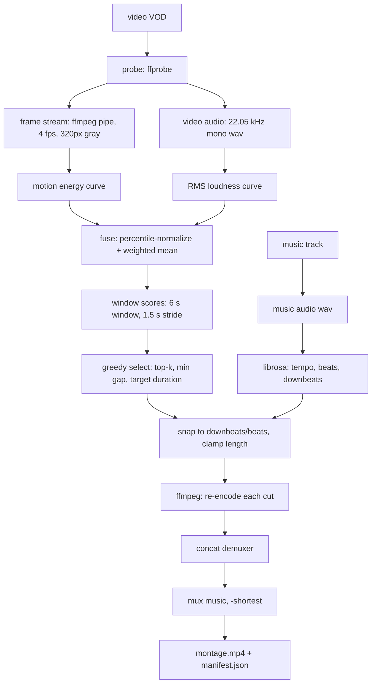

# Architecture

## Data flow

`pipeline.analyze()` stops right after `G`; `pipeline.run()` continues to `O`.
That split is what makes evaluation possible without rendering minutes of video.

## Module map

| Module | Responsibility | Depends on |
|---|---|---|
| `types.py` | `VideoInfo`, `Segment`, `BeatGrid` | nothing |
| `config.py` | validated run config, YAML loading | pyyaml |
| `media.py` | all `ffmpeg`/`ffprobe` subprocess calls | ffmpeg |
| `beats.py` | beat/downbeat estimation, snapping | librosa, numpy |
| `scoring.py` | per-timestamp interestingness curves | numpy, librosa |
| `select.py` | windows → non-overlapping segments | numpy |
| `render.py` | cut, concat, mux | ffmpeg |
| `pipeline.py` | orchestration + manifest | all of the above |
| `cli.py` | argument parsing only | pipeline |

`select.py`, `beats.snap/align_segment` and `scoring.normalize/fuse` are pure
functions with no I/O. That is intentional: they are the parts that are easy to
get subtly wrong, so they are the parts covered by tests.

## Design decisions

**Re-encode cuts instead of stream copying.**
`ffmpeg -c copy` can only start a clip on a keyframe, which on a 2-second GOP
means the cut can miss the beat by up to two seconds. Re-encoding costs time but
buys frame-accurate cuts. At 1080p60 with `veryfast`/`crf 20` the cut cost is
roughly real-time on the target laptop; NVENC is the M3 escape hatch.

**Stream frames through an ffmpeg pipe, not OpenCV.**
`VideoCapture` either decodes every frame (memory and time waste on a 60-minute
60 fps VOD) or seeks per sample (slow on long GOPs). Piping
`fps=4,scale=320:-2,gray` gives exactly the frames needed at a constant, small
memory cost.

**Score on two cheap signals first.**
Motion energy and loudness cost almost nothing and already beat random
selection. They also give a baseline that M2's learned detector must beat — a
number to compare against, instead of "the model looks better".

**Percentile normalization, not min-max.**
A single explosion would otherwise squash the rest of a 60-minute curve into the
bottom 5% of the range. Clipping at the 5th/95th percentile keeps the ranking
stable across very different recordings.

**Downbeats by onset phase.**
librosa gives beats but not bar boundaries. For 4/4 music, choosing the phase
`p` whose beats carry the strongest mean onset is a one-line heuristic that is
usually right. It is labelled as a heuristic in the code and is the first thing
to replace with BeatNet/madmom.

## Known failure modes

| Symptom | Likely cause | Fix |
|---|---|---|
| Cuts feel random | source has near-constant motion (racing, menu screens) | raise `window_s`, add a learned scorer |
| Montage is all one moment | `min_gap_s` too small relative to `window_s` | raise `min_gap_s` |
| Audio drifts out of sync | variable frame rate source | re-encode to CFR before the run |
| Cuts land on weak beats | `snap_tol_s` too large | lower it to 0.1–0.15 |
| Very slow on a long VOD | `sample_fps` / `frame_width` too high | lower both, benchmark first |
