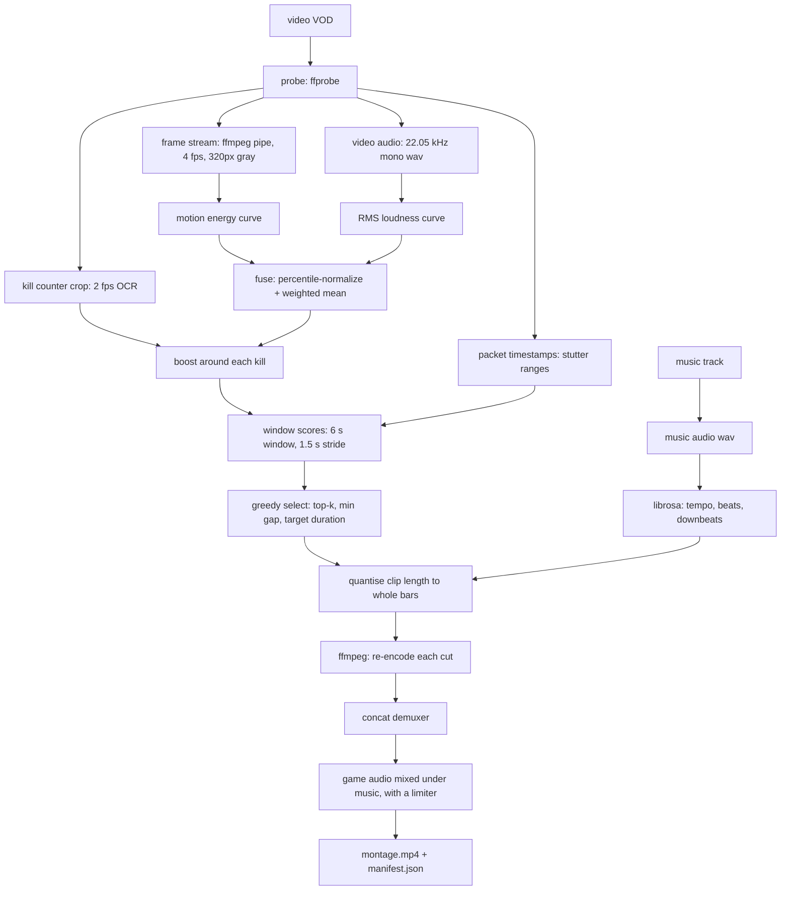

# Architecture

**English** | [Tiếng Việt](architecture.vi.md)

## Data flow

`pipeline.analyze()` stops right after `G`; `pipeline.run()` continues to `O`.
That split is what makes evaluation possible without rendering minutes of video.

Manual editor exports call `pipeline.run(..., segments=...)`: validated source
ranges bypass automatic analysis and retain the user's order and timestamps.
`editing.py` validates selections; `project.py` serializes and validates portable
edit decisions. See [project files](projects.md). Gameplay curves, music beats and
OCR results use separate cache entries so changing music reuses gameplay analysis.

## Module map

| Module | Responsibility | Depends on |
|---|---|---|
| `types.py` | `VideoInfo`, `Segment`, `BeatGrid`, `KillEvent` | nothing |
| `config.py` | validated run config, YAML loading | pyyaml |
| `media.py` | all `ffmpeg`/`ffprobe` subprocess calls | ffmpeg |
| `beats.py` | beat/downbeat estimation, duration quantisation | librosa, numpy |
| `scoring.py` | per-timestamp interestingness curves, event boosts | numpy, librosa |
| `scoreboard.py` | OCR the kill counter into events | ffmpeg, rapidocr |
| `select.py` | windows → non-overlapping segments | numpy |
| `render.py` | cut, concat, audio mix | ffmpeg |
| `cache.py` | remember curves and kills between runs | numpy |
| `evaluate.py` | precision@k, recall, IoU against labels | nothing |
| `pipeline.py` | orchestration + manifest | all of the above |
| `cli.py` | argument parsing only | pipeline |

`select.py`, `beats.quantize_duration`, `scoring.normalize/fuse/boost_curve` and
all of `evaluate.py` are pure functions with no I/O. That is intentional: they
are the parts that are easy to get subtly wrong, so they are the parts covered by
tests.

## Design decisions

**Re-encode cuts instead of stream copying.**
`ffmpeg -c copy` can only start a clip on a keyframe, which on a 2-second GOP
means the cut can miss the beat by up to two seconds. Re-encoding costs time but
buys frame-accurate cuts.

**Quantise clip length to whole bars.**
This is what actually puts the montage on the beat. The music is laid over the
*concatenated* result, so cut points sit at cumulative offsets: if every clip is
a whole number of bars and the music starts on a downbeat, every cut lands on a
bar line. Snapping the *source* timestamps to a beat grid aligns nothing — it is
unrelated to the music that gets laid on top later. Lengths are rounded on the
cumulative position rather than per clip, otherwise the error accumulates across
eight clips.

**Read the kill counter instead of a killfeed banner.**
A kill is the K/D/A digit going up: nothing to interpret, no banner to catch
mid-animation. Text detection is disabled (`use_det=False`) because the digit's
position is fixed, which took a frame from 242 ms to 11 ms. A rolling median
absorbs the moments where OCR glues a background pixel onto the digit.

**Detect dropped frames from packet timestamps, not frame timestamps.**
`-show_entries frame=` forces ffprobe to decode every frame; on 1170p60 HEVC that
takes minutes. Packets carry the same presentation timing and parse in about a
second because nothing is decoded. Packets arrive in decode order, so they must
be sorted by pts before diffing.

**Cache the two expensive things separately.**
The motion curve costs one full decode and depends only on the source and the
sampling settings. Kill detection costs its own OCR pass. They are cached under
different keys so tuning a selection parameter re-runs neither.

**Stream frames through an ffmpeg pipe, not OpenCV.**
`VideoCapture` either decodes every frame (memory and time waste on a 60-minute
60 fps VOD) or seeks per sample (slow on long GOPs). Piping
`fps=4,scale=320:-2,gray` gives exactly the frames needed at a constant, small
memory cost.

**Percentile normalization, not min-max.**
A single explosion would otherwise squash the rest of a 60-minute curve into the
bottom 5% of the range. Clipping at the 5th/95th percentile keeps the ranking
stable across very different recordings.

**Downbeats by onset phase.**
librosa gives beats but not bar boundaries. For 4/4 music, choosing the phase
`p` whose beats carry the strongest mean onset is a one-line heuristic that is
usually right. It is labelled as a heuristic in the code and is the first thing
to replace with BeatNet/madmom.

## Known failure modes

| Symptom | Likely cause | Fix |
|---|---|---|
| Cuts feel random | source has near-constant motion (racing, menu screens) | raise `window_s`, add a learned scorer |
| Montage is all one moment | `min_gap_s` too small relative to `window_s` | raise `min_gap_s` |
| Audio drifts out of sync | variable frame rate source | re-encode to CFR before the run |
| Cuts land on weak beats | `snap_tol_s` too large | lower it to 0.1–0.15 |
| Very slow on a long VOD | `sample_fps` / `frame_width` too high | lower both, benchmark first |
| A clip freezes mid-way | the source dropped frames while recording | `skip_frame_drops: true` (default) |
| OCR reads nonsense numbers | crop too wide, icons bleeding in | tighten the crop onto the digit |
