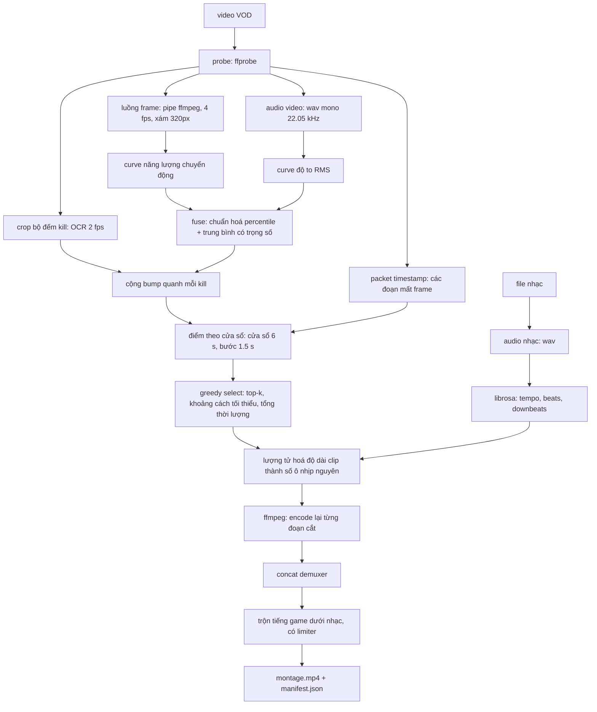

# Kiến trúc

[English](architecture.md) | **Tiếng Việt**

## Luồng dữ liệu

`pipeline.analyze()` dừng ngay sau `G`; `pipeline.run()` đi tiếp tới `O`. Chính
chỗ tách đó khiến việc đánh giá trở nên khả thi mà không phải render hàng phút
video.

## Bản đồ module

| Module | Trách nhiệm | Phụ thuộc |
|---|---|---|
| `types.py` | `VideoInfo`, `Segment`, `BeatGrid`, `KillEvent` | không có |
| `config.py` | config đã kiểm tra hợp lệ, nạp từ YAML | pyyaml |
| `media.py` | mọi lệnh con `ffmpeg`/`ffprobe` | ffmpeg |
| `beats.py` | ước lượng beat/downbeat, lượng tử hoá độ dài | librosa, numpy |
| `scoring.py` | các curve "chỗ này có gì đáng xem", cộng bump | numpy, librosa |
| `scoreboard.py` | OCR bộ đếm hạ gục → kill event | ffmpeg, rapidocr |
| `select.py` | cửa sổ → các segment không chồng lấn | numpy |
| `render.py` | cắt, concat, trộn âm thanh | ffmpeg |
| `cache.py` | nhớ lại curve và kill giữa các lần chạy | numpy |
| `evaluate.py` | precision@k, recall, IoU so với nhãn | không có |
| `pipeline.py` | điều phối + manifest | tất cả ở trên |
| `cli.py` | chỉ parse tham số | pipeline |

`select.py`, `beats.quantize_duration`, `scoring.normalize/fuse/boost_curve` và
`evaluate.py` là hàm thuần, không I/O. Cố ý như vậy: đây là những chỗ dễ sai một
cách tinh vi, nên cũng là những chỗ được test phủ.

## Các quyết định thiết kế

**Encode lại khi cắt, không stream copy.**
`ffmpeg -c copy` chỉ bắt đầu clip được ở keyframe, mà với GOP 2 giây thì mối cắt
có thể lệch beat tới 2 giây. Encode lại tốn thời gian nhưng mua được mối cắt
chính xác tới từng frame.

**Lượng tử hoá độ dài clip thành số ô nhịp nguyên.**
Đây là điều làm montage rơi vào nhịp. Nhạc được đắp lên *kết quả đã ghép*, nên
các mối cắt nằm ở vị trí cộng dồn. Nếu mỗi clip dài đúng một số ô nhịp nguyên và
nhạc bắt đầu ở downbeat thì mọi mối cắt đều rơi vào vạch ô nhịp. Việc bắt dính
timestamp *của nguồn* vào lưới beat là vô nghĩa — nó không liên quan gì tới nhạc
sẽ được đắp lên sau. Độ dài được làm tròn trên *vị trí cộng dồn* chứ không trên
từng clip, nếu không sai số sẽ tích luỹ qua tám clip.

**Đọc bộ đếm hạ gục thay vì killfeed dạng chữ.**
Một pha hạ gục chính là con số K/D/A tăng lên: không phải diễn giải chữ, không
phải canh banner xuất hiện đúng lúc. Tắt luôn bước dò chữ (`use_det=False`) vì vị
trí con số cố định, đưa chi phí từ 242 ms xuống 11 ms mỗi frame. Lọc trung vị theo
thời gian xử lý việc OCR dính pixel nền vào chữ số.

**Dò mất frame bằng packet timestamp, không bằng frame timestamp.**
`-show_entries frame=` buộc ffprobe giải mã từng frame; với HEVC 1170p60 điều đó
mất hàng phút. Packet mang cùng mốc thời gian trình chiếu và parse trong khoảng
một giây vì không giải mã gì cả. Packet đến theo thứ tự decode nên phải sắp xếp
theo pts trước khi tính hiệu.

**Cache riêng hai thứ đắt.**
Curve chuyển động tốn một lần giải mã toàn video và chỉ phụ thuộc vào file nguồn
cùng tham số lấy mẫu. Kill event tốn một lượt OCR riêng. Chúng được cache với khoá
khác nhau để chỉnh tham số chọn đoạn không phải chạy lại cái nào.

**Stream frame qua pipe của ffmpeg, không dùng OpenCV.**
`VideoCapture` hoặc giải mã mọi frame (hao thời gian và bộ nhớ với VOD 60 phút
60 fps), hoặc seek từng mẫu (chậm trên GOP dài). Pipe `fps=4,scale=320:-2,gray`
cho đúng số frame cần với chi phí bộ nhớ nhỏ và ổn định.

**Chuẩn hoá percentile, không min-max.**
Một vụ nổ duy nhất sẽ ép phần còn lại của curve 60 phút xuống 5% đáy. Cắt ở
percentile 5/95 giữ thứ hạng ổn định giữa những bản ghi rất khác nhau.

**Downbeat theo pha onset.**
librosa cho beat nhưng không cho vạch ô nhịp. Với nhạc 4/4, chọn pha `p` mà các
beat của nó có onset trung bình mạnh nhất là heuristic một dòng, thường đúng. Nó
được ghi rõ là heuristic trong code và là thứ đầu tiên nên thay bằng
BeatNet/madmom.

## Các kiểu hỏng đã biết

| Triệu chứng | Nguyên nhân khả dĩ | Cách sửa |
|---|---|---|
| Cắt có vẻ ngẫu nhiên | nguồn gần như chuyển động đều (đua xe, menu) | tăng `window_s`, thêm scorer có học |
| Montage toàn một khoảnh khắc | `min_gap_s` quá nhỏ so với `window_s` | tăng `min_gap_s` |
| Tiếng lệch dần | nguồn VFR | chuyển sang CFR trước khi chạy |
| Cắt rơi vào phách yếu | `snap_tol_s` quá lớn | hạ xuống 0.1–0.15 |
| Rất chậm trên VOD dài | `sample_fps` / `frame_width` quá cao | hạ cả hai, đo trước |
| Clip bị khựng giữa chừng | nguồn mất frame lúc quay | `skip_frame_drops: true` (mặc định) |
| OCR đọc ra số lạ | crop quá rộng, dính icon | crop sát vào con số |
